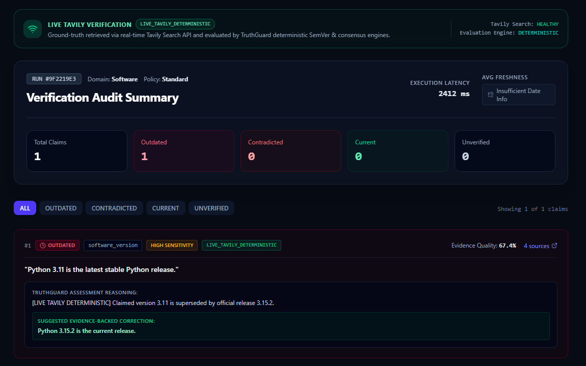

# TruthGuard AI

> **Don't Trust. Verify.**  
> *Stale-Answer Detector for AI Applications — Powered by Tavily Search API*

[](https://fastapi.tiangolo.com)
[](https://react.dev)
[](https://www.python.org)
[](https://tavily.com)

---

## 1. Project Overview

**TruthGuard AI** is a factual freshness and claim verification system built under the **AI Agents & Intelligent Systems** theme for the **Build a Stale-Answer Detector for AI Applications** problem statement (**Tavily Search API** track).

It inspects AI-generated answers, breaks them down into atomic factual claims, retrieves current primary evidence from the web via the **Tavily Search API**, evaluates evidence using deterministic and semantic verification logic, computes category-based freshness decay scores, and produces transparent verdicts with grounded source citations.



---

## 2. Problem Statement

Large Language Models learn facts from static training snapshots and answer with uniform confidence even after the underlying world changes:
- **Software releases and APIs advance:** Models may still recommend superseded versions (for example, stating *"Python 3.11 is the latest stable Python release"* after newer releases exist).
- **Pricing and tiers fluctuate:** Cloud infrastructure and API token pricing updates frequently.
- **Regulations and company metadata change:** Laws get amended or invalidated, and executive leadership changes over time.

Without source-backed verification against current web documentation, users and downstream applications cannot distinguish current facts from stale outputs.

---

## 3. Key Capabilities

- **Atomic Claim Decomposition:** Splits multi-sentence AI text into discrete claims with Subject-Predicate-Object structure, version strings, and date mentions.
- **Live Evidence Retrieval via Tavily:** Plans domain-tailored queries and fetches cleaned web snippets, canonical URLs, and available publication timestamps from Tavily `/search`.
- **Semantic Version Intent Detection:** Differentiates assertions claiming a version is *latest/current* from *historical milestones* (e.g., *"Kubernetes 1.20 deprecated dockershim"* is preserved as `CURRENT` rather than falsely flagged as outdated).
- **Five Verdict Categories:** Classifies every claim as `CURRENT`, `OUTDATED`, `CONTRADICTED`, `UNVERIFIED`, or `TIME_SENSITIVE`.
- **Mathematical Freshness & Evidence Quality Scoring:** Applies domain-specific exponential half-life decay and weights domain authority ($S$), Tavily relevance ($R$), and freshness ($F$).
- **Explicit Execution Provenance:** Separates `LIVE` runs (`LIVE_TAVILY`, `LIVE_TAVILY_DETERMINISTIC`) from `OFFLINE` fallback (`OFFLINE_DETERMINISTIC`, `OFFLINE_HEURISTIC_ANALYSIS`).

---

## 4. Architecture Overview

TruthGuard separates **evidence retrieval** (Tavily Search API) from **verification evaluation** (TruthGuard's deterministic and semantic engines):

```
User Input (AI Answer)
   │
   ▼
Claim Extraction & Classification (extraction_engine.py, classification_engine.py)
   │
   ▼
Targeted Query Planning (query_planner.py)
   │
   ▼
Tavily Live Web Search API — POST /search (tavily_adapter.py)
   │  └─ On unconfigured key / HTTP error / timeout ─▶ Explicit OFFLINE fallback
   ▼
Evidence Normalization, URL Validation & Source Reliability Scoring (reliability_engine.py)
   │
   ▼
Deterministic SemVer / Price / Consensus Evaluation (deterministic_engine.py, verification_engine.py)
   │
   ▼
Exponential Freshness & Evidence Quality Calculation (freshness_engine.py)
   │
   ▼
Persisted Run & Audit UI (PostgreSQL / SQLite fallback + React Dashboard)
```

For a detailed module-by-module walkthrough of every class, formula, and database table, see [`docs/PROJECT_ENGINEERING_GUIDE.md`](docs/PROJECT_ENGINEERING_GUIDE.md) and [`docs/ARCHITECTURE.md`](docs/ARCHITECTURE.md).

---

## 5. Technology Stack

- **Frontend:** React 19, TypeScript, Vite, Tailwind CSS, Lucide Icons, Recharts, React Router
- **Backend:** Python 3.12+, FastAPI, Pydantic v2, SQLAlchemy, Alembic, HTTPX, `packaging` (PEP 440)
- **Live Web Retrieval:** Tavily Search API (`https://api.tavily.com/search`)
- **Database:** PostgreSQL 16 (via Docker Compose) with automatic SQLite fallback (`sqlite:///./truthguard.db`) for local development and tests

---

## 6. Project Directory Structure

```text
truthguard-ai/
├── .env.example                     # Environment configuration template
├── docker-compose.yml               # PostgreSQL + FastAPI + Nginx frontend stack
├── backend/
│   ├── alembic/                     # Database schema migrations
│   ├── app/
│   │   ├── api/v1/endpoints/        # REST routes (/verify, /claims, /history, /metrics, /health, /integrations)
│   │   ├── core/                    # Settings (config.py) & prompt-injection guards (security.py)
│   │   ├── database/                # Session factory (session.py) & domain seeding (init_db.py)
│   │   ├── engines/                 # Extraction, classification, query planning, reliability, SemVer, freshness, verification
│   │   ├── integrations/            # Tavily Search API adapter (+ optional inactive LLM adapter)
│   │   ├── models/                  # SQLAlchemy ORM models (8 tables)
│   │   ├── schemas/                 # Pydantic v2 request/response contracts
│   │   └── services/                # Verification orchestration, history, and metrics services
│   ├── scripts/                     # Benchmark runners & live integration checks
│   └── tests/                       # 90 unit & integration tests + benchmark claim datasets
├── frontend/
│   └── src/
│       ├── components/              # Navbar, Footer, StatusBadge, FreshnessGauge
│       ├── pages/                   # Landing, Workspace, Results, EvidenceExplorer, Dashboard, History, Analytics, Settings
│       ├── services/                # Typed Fetch API client
│       └── types/                   # TypeScript interfaces mirroring backend schemas
└── docs/                            # Engineering guide, API docs, architecture, and benchmark reports
```

---

## 7. Prerequisites

- **Python 3.12+** (tested on Python 3.14)
- **Node.js 18+** and `npm`
- A **Tavily API key** from [tavily.com](https://tavily.com) for `LIVE` web verification (optional for running offline mode and unit tests)
- **Docker & Docker Compose** (optional, for containerized PostgreSQL setup)

---

## 8. Local Installation Instructions

```bash
git clone https://github.com/abhishekzirange/truthguard-ai.git
cd truthguard-ai
```

Create a Python virtual environment and install backend dependencies:

```bash
cd backend
python -m venv .venv
# Windows PowerShell:
.\.venv\Scripts\Activate.ps1
# Linux / macOS:
# source .venv/bin/activate

pip install -r requirements.txt
```

Install frontend dependencies:

```bash
cd ../frontend
npm install
```

---

## 9. Environment Variable Setup

Copy `.env.example` to `.env` in the repository root (or inside `backend/.env` when starting directly from `backend/`):

```bash
cp .env.example .env
```

Key settings in `.env.example`:

| Variable | Default | Purpose |
| :--- | :--- | :--- |
| `DATABASE_URL` | `sqlite:///./truthguard.db` | SQLAlchemy connection URI (PostgreSQL or local SQLite) |
| `TAVILY_API_KEY` | *(empty)* | Required for live Tavily `/search` calls; empty enables offline fallback |
| `BACKEND_HOST` / `BACKEND_PORT` | `0.0.0.0` / `8000` | Uvicorn server binding |
| `FRONTEND_URL` | `http://localhost:5173` | Allowed CORS frontend origin |
| `SEARCH_RESULTS_PER_CLAIM` | `5` | Default evidence limit per query |
| `SEARCH_CACHE_TTL_HOURS` | `24` | In-memory TTL cache duration for repeated Tavily queries |

> Note: `.env` and `*.db` files are listed in `.gitignore` and never committed.

---

## 10. Backend Startup Instructions

From the `backend/` directory:

```bash
# Run Alembic migrations and seed authoritative domain reliability scores
python -m alembic upgrade head
python -m app.database.init_db

# Start the FastAPI server
python -m uvicorn app.main:app --host 0.0.0.0 --port 8000 --reload
```

Verify backend readiness at `http://localhost:8000/api/v1/health`.

---

## 11. Frontend Startup Instructions

From the `frontend/` directory:

```bash
npm run dev
```

Open `http://localhost:5173/` in your browser. Use **Verify** (`/workspace`) to audit text, inspect **Results** (`/results/:id`), or check Tavily connectivity in **Settings** (`/settings`).

*(Alternatively, run `docker compose up --build` from the repository root to start PostgreSQL, FastAPI, and Nginx together.)*

---

## 12. API Documentation Instructions

FastAPI automatically serves interactive API documentation when the backend is running:
- **Swagger UI:** `http://localhost:8000/docs`
- **ReDoc:** `http://localhost:8000/redoc`
- Static endpoint reference with example payloads: [`docs/API_DOCUMENTATION.md`](docs/API_DOCUMENTATION.md)

Primary endpoints under `/api/v1`:
- `POST /verify` — Submit an AI-generated answer for verification
- `GET /verify/{verification_id}` — Fetch run summary, claims, assessments, and evidence
- `GET /claims/{claim_id}/evidence` — Fetch raw retrieved evidence items for a claim
- `GET /history` — List previous runs with pagination
- `GET /metrics` — Aggregate dashboard statistics
- `GET /integrations/status` — Live connectivity ping for Tavily and Database
- `GET /health` — Service and database health check

---

## 13. Tavily Integration Explanation

In [`backend/app/integrations/tavily_adapter.py`](backend/app/integrations/tavily_adapter.py), `TavilyAdapter.search()` sends an async `POST` request to `https://api.tavily.com/search` with:
- `query`: Planned query from `QueryPlanner.plan_query()` (which strips stale version numbers on latest-release assertions so newer releases appear in results).
- `search_depth`: `"basic"` or `"advanced"` based on claim temporal sensitivity / verification depth.
- **Resilience & Security:** Retries transient `429` rate limits and `5xx` errors with exponential backoff; caches clean hits in memory for `SEARCH_CACHE_TTL_HOURS`; validates every returned URL through `validate_and_sanitize_url()` (strictly `http`/`https`, rejecting `javascript:`, `data:`, `file:`, and malformed hosts); preserves real `published_date` values without synthesizing missing dates.

---

## 14. Offline Fallback Explanation

If `TAVILY_API_KEY` is unconfigured, invalid (`401`), rate-limited (`429`), or timed out:
1. `TavilyAdapter` returns `live_success=False` along with a structured error code (`TAVILY_KEY_NOT_CONFIGURED`, `TAVILY_AUTH_ERROR`, `TAVILY_TIMEOUT`, etc.) and draws from a small static fallback fixture set (`DEMO_GROUND_TRUTH_EVIDENCE`) where keywords match.
2. `VerificationService` records `run.execution_mode = "OFFLINE"` and records claim provenance as `OFFLINE_DETERMINISTIC` or `OFFLINE_HEURISTIC_ANALYSIS`.
3. The frontend displays explicit `OFFLINE` status banners and never labels an offline or failed-Tavily run as `LIVE`.

---

## 15. Benchmark Methodology & Results

TruthGuard AI includes two 100-claim human-reviewed evaluation datasets executed in **strictly offline mode** (external API keys cleared in-process) on **2026-11-12**:

| Evaluation Suite | Mode | Overall Accuracy | Outdated Recall | Outdated Precision | Outdated F1 | FPR | Confusion Matrix (`OUTDATED`) |
| :--- | :--- | :--- | :--- | :--- | :--- | :--- | :--- |
| **Original 100 Claims** ([report](docs/BENCHMARK_RESULTS.md)) | Offline Fixture Corpus | **69.00%** (69/100) | **88.00%** (22/25) | **88.00%** (22/25) | **0.880** | **4.00%** (3/75) | `TP=22, FP=3, FN=3, TN=72` |
| **Independent Holdout** ([report](docs/HOLDOUT_BENCHMARK_RESULTS.md)) | Offline Zero-Corpus | **33.00%** (33/100) | **50.00%** (8/16) | **57.14%** (8/14) | **0.533** | **7.14%** (6/84) | `TP=8, FP=6, FN=8, TN=78` |
| **Live Tavily Pipeline** | Live Web Retrieval | **Not yet measured** | **Not yet measured** | **Not yet measured** | **Not yet measured** | **Not yet measured** | Demonstrated on selected live cases |

**Why Holdout Offline Accuracy is Lower:** Without live web search, unseen claims fall back conservatively to `UNVERIFIED` rather than guessing. Live Tavily retrieval addresses this evidence gap at runtime (verified on selected examples such as `Python 3.11 -> 3.15.2` and `Kubernetes 1.20`), while a full 100-claim live benchmark has not yet been executed.

---

## 16. Testing Instructions

```bash
# Backend unit & integration tests (90 tests; conftest.py isolates tests from external APIs)
cd backend
python -m pytest tests/

# Frontend linter and TypeScript production build
cd ../frontend
npm run lint
npm run build
```

---

## 17. Known Limitations

1. **Unmeasured Full-Scale Live Benchmark:** Live Tavily accuracy, recall, and precision have been tested on targeted examples, not across all 100 claims.
2. **Rule-Based Evidence Interpretation:** Without an active LLM reasoning gateway, subtle natural-language contradictions outside deterministic SemVer, pricing, and semantic patterns fall back to `UNVERIFIED`.
3. **Missing Publication Timestamps:** When web sources omit publication metadata, `published_at` remains `null` and `freshness_score` reports `null` (*Insufficient Date Info*) rather than estimating dates.
4. **Paywalled & Script-Blocked Pages:** Verification quality depends on the text snippets Tavily indexes from accessible pages.

---

## 18. Future Improvements

- Execute full 100-claim live Tavily evaluations alongside larger independent holdout sets.
- Improve multi-source contradiction resolution when credible web pages disagree.
- Expand domain reliability registries and structured release-date extraction.
- Package reusable Python/TypeScript client SDKs for integrating TruthGuard checks into RAG pipelines.

---

## 19. License

Declared under the **MIT License** in project documentation (no standalone `LICENSE` file is currently included in the repository root).

---

## 20. GitHub Repository

- **Repository:** [https://github.com/abhishekzirange/truthguard-ai](https://github.com/abhishekzirange/truthguard-ai)
- **Technical Reference:** [`docs/PROJECT_ENGINEERING_GUIDE.md`](docs/PROJECT_ENGINEERING_GUIDE.md)
- **Readiness Report:** [`docs/FINAL_HACKATHON_READINESS_REPORT.md`](docs/FINAL_HACKATHON_READINESS_REPORT.md)
