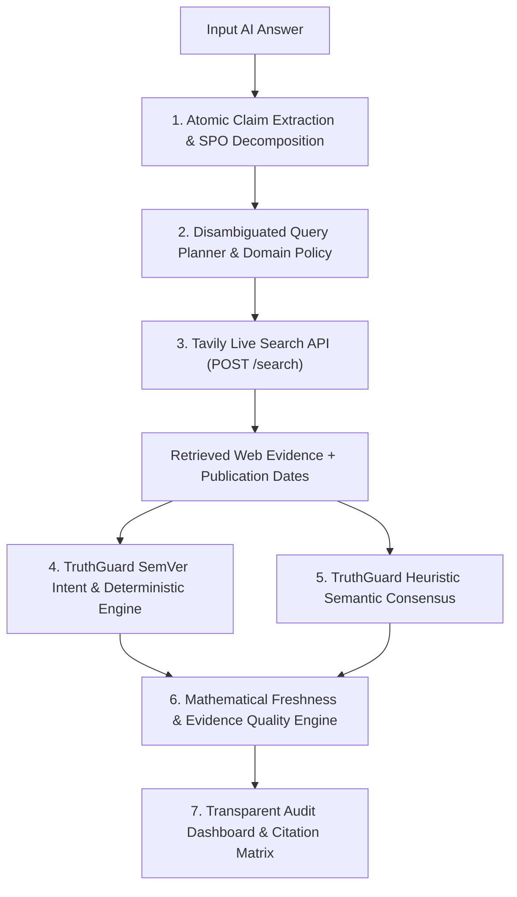

# TruthGuard AI — Tavily Track Hackathon Submission Package

**Primary Hackathon Theme:** Build a Stale-Answer Detector for AI Applications  
**Project Category:** AI Reliability & Information Freshness Intelligence  
**Technology Sponsor Track:** **Tavily Search API**  
**Product Name:** TruthGuard AI  
**Tagline:** Don't Trust. Verify.  
**Repository:** [https://github.com/abhishekzirange/truthguard-ai](https://github.com/abhishekzirange/truthguard-ai)  
**Supporting Audit Docs:**
- [Offline 100-Claim Benchmark Report](https://github.com/abhishekzirange/truthguard-ai/blob/main/docs/BENCHMARK_RESULTS.md)
- [Independent Holdout Benchmark Report](https://github.com/abhishekzirange/truthguard-ai/blob/main/docs/HOLDOUT_BENCHMARK_RESULTS.md)
- [Final Technical Readiness Report](https://github.com/abhishekzirange/truthguard-ai/blob/main/docs/FINAL_HACKATHON_READINESS_REPORT.md)

---

## 1. Project Overview & Elevator Pitch

Large Language Models (ChatGPT, Claude, Gemini) generate answers containing outdated, superseded, or contradicted information with high confidence. When APIs evolve, pricing tiers shift, regulations change, or corporate leadership transitions, static model weights produce costly enterprise hallucinations.

**TruthGuard AI** is a verification and information freshness intelligence platform built for the **Tavily Stale-Answer Detection** hackathon theme. **Tavily Search API retrieves current primary web evidence**, and **TruthGuard AI's deterministic and semantic consensus engines independently evaluate** whether extracted claims are `CURRENT`, `OUTDATED`, `CONTRADICTED`, or `UNVERIFIED`, scoring temporal freshness with exponential half-life decay ($100 \times 2^{-\Delta t / t_{\text{half}}}$).

---

## 2. Problem Statement & Why Tavily is Essential

### The Core Problem: LLM Temporal Blindness
1. **Knowledge Cutoffs & Temporal Drift:** Static model weights cannot detect that a software release was superseded or that an executive resigned after training cutoff.
2. **Confident Stale Claims:** LLMs state *"Python 3.11 is the latest stable release"* or *"Twitter is led by CEO Jack Dorsey"* with no uncertainty signal.
3. **Enterprise Risk:** Unverified stale answers cause broken software dependencies, inaccurate cost estimates, and regulatory compliance errors.

### Why Tavily Search API is Essential
Raw HTML scraping or generic keyword search returns noisy pages cluttered with ads, navigation chrome, and boilerplate. **Tavily Search API** provides the clean factual foundation that TruthGuard's evaluation engine needs:
- **Noise-Free Factual Snippets:** Clean extracted text passages focused on factual content.
- **Targeted Query Execution:** Precision retrieval from disambiguated Subject-Predicate-Object verification queries.
- **Canonical Primary Sources:** High-signal results from official documentation portals (`docs.python.org`, `python.org`, `kubernetes.io`, `curia.europa.eu`).
- **Publication Timestamp Normalization:** Temporal anchors (preserved without fabrication) for mathematical decay scoring.

---

## 3. System Architecture & Pipeline

> **Separation of Responsibilities:** Tavily retrieves authoritative evidence from the live web; TruthGuard's deterministic SemVer parser (PEP 440), price extractor, and semantic consensus rules interpret that evidence to produce a verifiable verdict.



### Step-by-Step Pipeline Architecture
1. **Atomic SPO Decomposition:** Breaks multi-sentence AI answers into discrete atomic factual claims (`subject`, `predicate`, `object`, `category`, `mentioned_version`).
2. **Disambiguated Query Planning:** Generates focused search queries (for latest-release assertions, strips stale version numbers from the search query so current releases surface cleanly).
3. **Tavily Live Retrieval (`POST /search`):** Queries live web sources, attaches domain authority scores ($S$), and parses available publication dates without inventing timestamps.
4. **Deterministic Evaluation Engine:**
   - **SemVer + Intent Classification (PEP 440):** Distinguishes `LATEST_ASSERTION` (*"Python 3.11 is the latest"* $\rightarrow$ compared against retrieved releases) from `HISTORICAL_MILESTONE` (*"Kubernetes 1.20 deprecated dockershim"* $\rightarrow$ checked for historical corroboration). Dynamically extracts versions directly from retrieved evidence without hardcoded facts.
   - **Price & Semantic Consensus Rules:** Checks currency/numeric claims, leadership succession cues, merger cancellations, and legal framework invalidation markers.
5. **Freshness & Quality Scoring:** Calculates category-specific exponential half-life decay and evidence quality weights.
6. **Honest Execution Provenance:** Displays `LIVE` (`LIVE_TAVILY` / `LIVE_TAVILY_DETERMINISTIC`) **only** when live Tavily retrieval succeeds. If Tavily fails or is unconfigured, degrades explicitly to `OFFLINE` (`OFFLINE_DETERMINISTIC` / `OFFLINE_HEURISTIC_ANALYSIS`).

---

## 4. Mathematical Freshness & Quality Models

### A. Domain Half-Life Exponential Decay
$$\text{Freshness} = 100 \times 2^{-\frac{\Delta t}{t_{\text{half}}}}$$

| Category | Half-Life ($t_{\text{half}}$) | Rationale |
| :--- | :--- | :--- |
| **Product Pricing** | 7 days | Cloud API pricing and SaaS tiers fluctuate frequently. |
| **Software Versions** | 30 days | Rapid release cadences and security patches. |
| **API Documentation** | 30 days | Endpoint deprecations and SDK updates. |
| **Regulations & Policy** | 90 days | Statutory deadlines and regulatory rulings. |
| **Company Information** | 90 days | Executive transitions, earnings, and M&A deals. |
| **General Technical Facts** | 365 days | Stable protocols and architectural concepts. |

### B. Epistemic Evidence Quality Scoring
$$\text{Evidence Quality} = 100 \times \left( 0.45 \cdot S + 0.35 \cdot R + 0.20 \cdot \frac{F}{100} \right)$$
- $S \in [0.0, 1.0]$: Source Domain Reliability (Official docs/registries = 1.0, reputable news = 0.85, blogs = 0.45–0.50).
- $R \in [0.0, 1.0]$: Search Relevance Score returned by Tavily.
- $F \in [0, 100]$: Freshness Score.

---

## 5. Benchmark Performance & Honest Evaluation Disclosures

All offline benchmarks below were executed strictly on `2026-11-12` with external APIs disabled to isolate the local deterministic/heuristic engine. **Live Tavily pipeline accuracy across full 100-claim benchmarks is not yet measured**; live behavior has been demonstrated and verified on selected real-world test cases.

| Evaluation Tier | Mode | Overall Accuracy | Outdated Recall | Outdated Precision | Outdated F1 | False Positive Rate | Avg Latency |
| :--- | :--- | :--- | :--- | :--- | :--- | :--- | :--- |
| **Original 100-Claim Benchmark** | Offline Fixture Corpus | **69.00%** (69/100) | **88.00%** (22/25) | **88.00%** (22/25) | **0.880** | **4.00%** (3/75) | 18.3 ms |
| **Independent Holdout (100 Claims)** | Offline Zero-Corpus | **33.00%** (33/100) | **50.00%** (8/16) | **57.14%** (8/14) | **0.533** | **7.14%** (6/84) | 18.1 ms |
| **Live Tavily Pipeline** | Live Web Retrieval | **Not yet measured** | **Not yet measured** | **Not yet measured** | **Not yet measured** | **Not yet measured** | ~1.8s – 2.5s (demonstrated) |

### Confusion Matrices (Offline Runs on 2026-11-12)

- **Original 100-Claim Benchmark (`benchmark_100_claims.json`):** `TP = 22`, `FP = 3`, `FN = 3`, `TN = 72` (Total Outdated = `25`, Not Outdated = `75`).
- **Independent Holdout Benchmark (`holdout_100_claims.json`):** `TP = 8`, `FP = 6`, `FN = 8`, `TN = 78` (Total Outdated = `16`, Not Outdated = `84`).

### Metric Reconciliation & Offline Engine Limitations
1. **Reconciling Holdout & Baseline Figures:**
   - The earlier `2026-11-02` baseline (commit `d7af0a5`) recorded holdout precision of **53.33%** (`8/15`, `FP=7`) and original recall of **92.00%** (`23/25`, `FP=4`).
   - Subsequent hardening of `DeterministicEngine` to exclude stray non-version numbers (such as `$10 million`, file sizes `42.8 MB`, `DD.MM.YYYY` dates, and `PEP`/`RFC` identifiers) removed 1 false positive in the holdout (`FP: 7 -> 6`, precision **57.14%** `8/14`) and removed 1 FP plus 1 accidental `$10`-matched TP (`claim-020`, Docker 1.13) in the original set (`TP: 23 -> 22`, `FP: 4 -> 3`, accuracy preserved at **69.00%**).
   - An earlier draft of this document mistakenly showed `12/24` and `12/21` in the holdout summary; those erroneous denominators have been corrected to match the actual confusion matrix (`8/16` recall, `8/14` precision).
2. **Offline Limitations Explained:**
   - Without live Tavily web retrieval, the offline engine cannot verify unseen or newly emerging claims (pricing changes, new releases, recent executive moves). In blind holdout testing without external web search, unseen claims predominantly classify as `UNVERIFIED` (avoiding fabricated verdicts), which explains why offline holdout accuracy is 33.00%.
   - Live Tavily integration resolves evidence retrieval gaps dynamically at query time, though full-dataset live evaluation metrics remain to be measured.

---

## 6. Live Tavily Demonstration Walkthrough (Verified 2026-11-12)

### Verified Live Example — Python Release Check
- **Timestamp (UTC):** `2026-11-12T08:09:35.574285+00:00`
- **Input Claim:** `"Python 3.11 is the latest stable Python release."`
- **Official Source Verification:** At test time (`2026-11-12`), official Python releases (`https://www.python.org/downloads/release/python-3152` and `https://www.python.org/downloads`) confirm **Python 3.15.2** (released **Oct. 25, 2026**, following the PEP 790 3.15 schedule starting Oct. 2026; 3.16 is pre-release).
- **Pipeline Output:**
  - **Execution Mode:** `LIVE` (Latency: `1881 ms`)
  - **Planned Query:** `Python latest stable release version official documentation`
  - **Tavily Retrieved Sources:**
    - `What's New In Python 3.13` ([docs.python.org](https://docs.python.org/3/whatsnew/3.13.html))
    - `What's new in Python 3.14 — Python 3.15.2 documentation` ([docs.python.org](https://docs.python.org/3/whatsnew/3.14.html))
    - `Latest Python Version (2025) – What's New in Python 3.14?` ([liquidweb.com](https://www.liquidweb.com/blog/latest-python-version))
    - `Python documentation by version | Python.org` ([python.org](https://www.python.org/doc/versions))
  - **Verdict:** `OUTDATED` (`LIVE_TAVILY_DETERMINISTIC`)
  - **Suggested Correction (Extracted Dynamically from Retrieved Evidence):** `"Python 3.15.2 is the current release."`

### Judge Demo Script (5-Minute Walkthrough)
1. **Open Workspace:** Navigate to `http://localhost:5173/workspace`. Confirm the header badge reads `Stale-Answer Detector (Tavily Track)` and `Tavily Live Search: ONLINE`.
2. **Test Outdated Software Version:** Paste `"Python 3.11 is the latest stable Python release."` and click **Audit Answer**. Point out the extracted claim, live `LIVE TAVILY VERIFICATION` banner, `docs.python.org` evidence cards, `OUTDATED` verdict, and dynamic `"Python 3.15.2 is the current release."` correction.
3. **Test Historical Milestone Preservation:** Paste `"Kubernetes 1.20 deprecated dockershim."` and click **Audit Answer**. Point out that TruthGuard detects historical intent (`HISTORICAL_MILESTONE`) and marks it **`CURRENT`** rather than falsely flagging a historical fact as stale.
4. **Inspect Evidence Matrix:** Click **Open Evidence Explorer** to view source domain authority, relevance ranking, freshness decay scores, and safe `noopener noreferrer` links.

---

## 7. Setup & Local Execution Guide

### Prerequisites
- Python 3.12+
- Node.js 18+ & npm
- Tavily API Key

### 1. Configure Environment
```bash
git clone https://github.com/abhishekzirange/truthguard-ai.git
cd truthguard-ai
```
Create `.env` in the repository root (already listed in `.gitignore`):
```env
TAVILY_API_KEY=<your-tavily-api-key>
DATABASE_URL=sqlite:///./truthguard.db
ENVIRONMENT=development
PORT=8000
```

### 2. Start Backend API
```bash
cd backend
python -m venv venv
.\venv\Scripts\activate   # Windows (use source venv/bin/activate on Linux/macOS)
pip install -r requirements.txt
python -m uvicorn app.main:app --host 0.0.0.0 --port 8000
```

### 3. Start Frontend UI
```bash
cd ../frontend
npm install
npm run dev
```
Open `http://localhost:5173/`.

### 4. Run Automated Tests
```bash
cd ../backend
python -m pytest tests/
```

---

## 8. Explicit System Limitations

1. **Unmeasured Large-Scale Live Benchmark:** Live Tavily accuracy, recall, and precision have been validated on targeted demo examples, not yet across the full 100-claim corpora due to API quota and reproducibility variance.
2. **Rule-Based Evidence Interpretation:** In Tavily-only mode (with no external LLM gateway), evidence evaluation relies on PEP 440 SemVer comparison, numeric pricing bounds, and lexical semantic rules; complex nuanced phrasing outside those rules may fall back to `UNVERIFIED`.
3. **Source Accessibility & Timestamps:** Paywalled websites or pages without exposed publication metadata limit extraction to Tavily snippet previews, without fabricating missing dates.
4. **Offline Mode Constraints:** When Tavily is unreachable or unconfigured, TruthGuard explicitly drops to `OFFLINE` mode and only detects patterns covered by local heuristics and fixture data.

---

## 9. Hackathon Submission Portal Field Answers

- **Project Title:** TruthGuard AI
- **Primary Theme / Category:** Build a Stale-Answer Detector for AI Applications (Tavily Track)
- **Tagline:** Don't Trust. Verify.
- **Short Description:** An information freshness verification platform that uses Tavily Search API to retrieve current primary web evidence and independently evaluates whether claims in AI answers are current, outdated, contradicted, or unverified.
- **How was Tavily used?**  
  Tavily Search API powers real-time evidence retrieval. TruthGuard decomposes AI answers into atomic Subject-Predicate-Object claims, plans disambiguated verification queries, and calls Tavily's `/search` endpoint to fetch clean authoritative web snippets and publication dates. TruthGuard's PEP 440 SemVer, pricing, and semantic consensus engines then interpret those live results to detect stale facts and propose grounded corrections.
- **What makes this project unique?**  
  1. Strict separation between evidence retrieval (Tavily) and deterministic evaluation (SemVer intent detection + semantic rules) with honest `LIVE` vs `OFFLINE` provenance badges.  
  2. Semantic version intent classification that avoids false positives on historical statements (*"Kubernetes 1.20 deprecated dockershim"*).  
  3. Domain-specific half-life freshness decay scoring (7d pricing, 30d software, 90d regulations) with `noopener noreferrer` primary source citations.
- **Tech Stack:** Python, FastAPI, SQLAlchemy, Alembic, SQLite/PostgreSQL, HTTPX, Pydantic v2, Tavily Search API, React 19, TypeScript, Vite, Tailwind CSS.
- **GitHub Repository:** [https://github.com/abhishekzirange/truthguard-ai](https://github.com/abhishekzirange/truthguard-ai)
